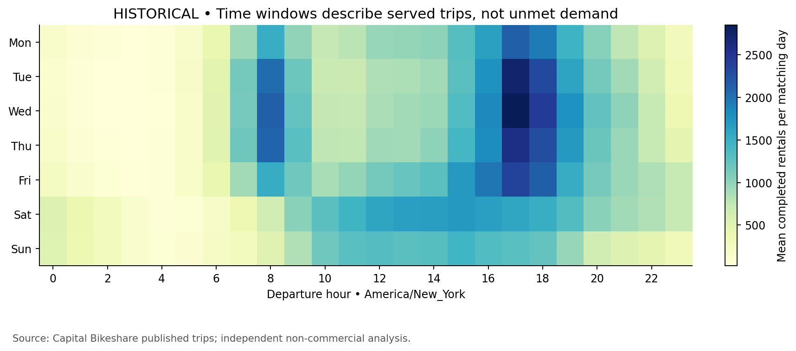

# Can I rely on this bike?

**Measuring bike-share reliability and designing a better commute experience**

**Status: historical analysis and a tested collection workflow are complete; prospective availability remains a technical pilot.** Two live snapshots span only 95 seconds. They cannot support weekday reliability rankings or a launch decision. No real product experiment has been run.

Independent, non-commercial portfolio project using Capital Bikeshare's published data. No operator affiliation or endorsement.

## The product decision

A rider planning a regular journey needs a suitable bike at departure and a practical return option. Completed rentals show what the service delivered; they do not show everyone who tried and failed. This project separates physical availability, information freshness, rider decisions and journey outcomes.

**Recommendation:** validate a saved-journey check that combines timely station information with acceptable nearby alternatives, then test rental success after an explicit departure intent. The existing app already shows bike and dock counts. The opportunity is incremental help at a useful moment, subject to a current-product audit and rider research—not a claim that maps or alerts are missing.

## What the evidence says

**Historical · August–October 2026:** three entire published archives, 2,000,497 rows; 1,999,232 eligible rentals after documented exclusions. Grouping uses actual local start month, not archive name. This is published served activity, not a census of attempted journeys.

- Monthly eligible rentals: **645,596**, **676,343**, **677,293**. These counts do not establish growth caused by a product change.
- **14.5%** lack a departure station ID and **15.3%** an arrival station ID. They remain in overall volume; station analyses use the relevant known-station denominator. Missing endpoints are concentrated in electric-bike records; their precise causes are unobserved.
- **71.4%** are electric-bike rentals and **71.5%** carry a member label. Neither label identifies a person or journey purpose.
- Columbus Circle / Union Station leads observed departures in the assumed core weekday windows (**8,281**). It is an investigation candidate, not a proven stockout location. Widening those windows retains **8 of the top 10** candidates.

**Prospective · 13 November 2026:** two successful snapshots covering a frozen universe of 875 stations. Feed and station ages differ; stale reports exist. The collector and interval metrics work, but observation time must mature before recurring-service claims.

**Synthetic · separate demonstration:** 2,000 repetitions/scenario validate simple first-intent proportion differences and expose biased missing-outcome, immature-follow-up and repeated-event analyses. Null false positives were 4.8% (Monte Carlo SE 0.48 pp). These are simulation diagnostics, never observed product effects.



## How to test the proposal

Persistent account allocation, with eligibility and first departure-intent confirmation defined before treatment. Primary ITT outcome: an acceptable rental start within 15 minutes of that first intent. Operator app/ledger linkage is essential; public trips cannot measure it. Guardrails cover return difficulty, detours, freshness and safety. A hypothetical 70% baseline and +2 pp useful effect imply 8,079 mature users/arm for 80% power under simple independent-user assumptions.

Recommendations move demand between stations. The initial account contrast targets own-assignment benefit at the tested saturation, not full-rollout impact; inventory dependence must be assessed before confirmatory inference. Geographic cluster and switchback alternatives need their own calibrated power and operational design. See the [experiment proposal](docs/experiment_design.md).

## Reproduce

Python 3.10–3.12, macOS/Linux; commands run from this checkout's root. Install [uv](https://docs.astral.sh/uv/getting-started/installation/) and then:

```bash
uv sync --frozen --extra dev
# Feasibility only; first N rows are not a representative sample:
uv run bikeshare history --months 202610 --limit 1000
# Replace the sample with all three complete source files:
uv run bikeshare history --months 202608 202609 202610
uv run dbt build --project-dir dbt --profiles-dir dbt
uv run bikeshare collect --count 1
uv run bikeshare collect --count 10 --interval 120
uv run bikeshare report
uv run bikeshare simulate --repetitions 2000 --users 4000 --seed 20261113
bash scripts/validate.sh
```

The last script runs offline fixture tests (including an actual dbt build), lint, compilation and checks on committed aggregate outputs. Package installation and source ingestion need network; CI validation needs no credentials or source access after installation. Historical ingestion replaces each requested source month, so reruns do not append duplicates. A first-row limit is recorded in provenance and must be removed before publishing full-month findings.

Raw data, DuckDB files and source caches are excluded from Git under the [data licence](https://capitalbikeshare.com/data-license-agreement). The [source manifest](reports/source_manifest.json) records download URLs, times, hashes and sizes without redistributing the dataset. Re-downloading may yield a publisher revision; compare hashes before comparing results. Prospective observations are time-specific and cannot be recreated later; new collection produces a new evidence window. Pause scheduled collection before database writes or reporting. Optional `MPLCONFIGDIR=work/mpl` keeps the plotting cache local.

## Review the portfolio

| Output | What to read |
|---|---|
| Product recommendation | [Decision, evidence and next gates](docs/product_recommendation.md) |
| Product framing | [Target journey and existing functionality](docs/product_brief.md) |
| Measurement | [Formulas, denominators and sensitivities](docs/measurement_framework.md) |
| Methodology | [Cohorts, missingness, time and uncertainty](docs/methodology.md) |
| Experiment | [Eligibility, ITT, power and interference](docs/experiment_design.md) |
| Tracking | [Events, linkage and data-quality contract](docs/tracking_plan.md) |
| Review | [Issues found, corrections and remaining limits](docs/analytical_review.md) |
| Simulation | [Assumptions and repeated diagnostics](docs/simulation.md) |
| Interview preparation | [Choices and challenges in plain language](docs/interview_notes.md) |
| Sources and operations | [Source verification](docs/data_sources.md), [collection runbook](docs/collection_runbook.md), [decision log](docs/decision_log.md) |

All **six charts** are in [reports/figures](reports/figures): daily rentals; weekday/hour timing; category/type mix; investigation candidates and window sensitivity; synthetic diagnostics; departure/arrival timing. Titles explicitly distinguish historical and simulated evidence. No live reliability chart is presented from a 95-second pilot.

## What remains uncertain

No public attempted-journey denominator, stable user ID, historical availability archive in the official sources reviewed, or causal feature evidence. Current station metadata cannot establish historical capacity. Polling misses between-snapshot changes; closures and unobserved periods are not stockouts. Two weeks of collection would be exploratory; plan 8–12 weeks before assessing recurrence and possible future-week inference, subject to coverage and dependence checks. More rides alone would not establish reduced emissions.

Next: follow the [local scheduling instructions](docs/collection_runbook.md), audit the current app, conduct rider research, and validate operator-side intent/rental linkage. Mature station-window analysis and a confirmatory field trial remain future work. [PROJECT_STATUS.md](PROJECT_STATUS.md) records delivery and evidence gates.
